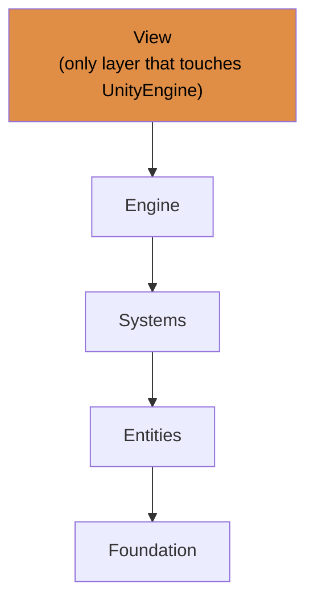

# ZERO
### A wave-survival game in Unity with zero MonoBehaviours.
_Optimization class · personal challenge_

---

ZERO is a small arena survival game where **all gameplay logic lives in a plain C# simulation that has no idea Unity exists**. Movement, collisions, combat, enemy AI and wave progression all run there. Unity is reduced to a thin view layer: it reads the keyboard and mouse, then draws whatever the simulation reports.

The assignment allowed up to four MonoBehaviours. I set myself a harder target of zero, as a way to practice architecture and performance-minded design rather than just meeting the requirements.

## Highlights
- **0 MonoBehaviour scripts.** The game boots itself and hooks into Unity's PlayerLoop at a single point. There are no per-object `Update()` calls.
- **Simulation / view separation.** The view reads a pre-allocated snapshot of the world and never touches simulation state.
- **Five layers, dependencies point one way,** enforced with assembly definitions. Only the view layer references `UnityEngine`.
- **Allocation-conscious by design:** fixed-capacity entity storage, struct snapshots, and pooled enemy and bullet views.
- **Unit-tested systems.** NUnit tests cover movement, cleanup, collision, combat, player control and wave progression. They never touch a scene or a GameObject.
- **Data-driven waves.** Each wave is a plain struct: enemy count, spawn radius, health and damage scaling, and an end condition (kill percentage or timer).

## Gameplay
- Move with WASD / arrow keys and aim with the mouse. The player fires automatically on a cooldown.
- Enemies spawn on a ring around the arena center and chase the player.
- Win by getting through every wave. Lose when your health reaches zero.

## Goals
- Meet the brief (consecutive waves with rising difficulty, enemies that move, take damage and die, clear win and loss conditions, a player who can eliminate enemies) with no MonoBehaviours.
- Keep the simulation fully independent of UnityEngine, so it can be tested in isolation.
- Treat per-frame cost and memory as design inputs: pre-allocate, avoid per-entity update calls, pool views.
- Practice test-first design on the logic-heavy systems, and using TDD (red, green, refactor) for writing code iteratively while maintaining high code quality through refactoring.

## Architecture
The design borrows ideas from data-oriented design and ECS (entities are plain data, systems transform them), but it is deliberately small and is not a full ECS.

### One Frame
1. `InputReader` samples the keyboard and mouse into a plain struct.
2. `SimulationEngine` runs the systems in a fixed order: cleanup, player control, bullet lifetime, enemy AI, movement, collision, combat, waves.
3. The engine writes the world into a pre-allocated snapshot and swaps buffers.
4. `ViewBridge` reads the snapshot and moves pooled GameObjects to match.

All four steps run from one delegate injected into Unity's PlayerLoop right after `EarlyUpdate`.

**Good places to start reading:** `GameBootstrap` (how everything is wired), `SimulationEngine` (the tick), `EntityRegistry` (storage and IDs), `and any *Tests` file (how systems are tested).

## Challenges

**1. Starting a game with no MonoBehaviour.** Something still has to tick the simulation. A `[RuntimeInitializeOnLoadMethod]` bootstrap builds everything and injects a single delegate into the PlayerLoop. That bootstrap is the only place that knows how the pieces fit together: the engine receives its systems from outside and never knows which one is which.
 
**2. Identity without GameObjects.** Entities live in fixed slots, so a new enemy can land in the slot of one that just died, and old references would silently point at the wrong entity. IDs are a slot plus a generation counter. Reading through a stale ID throws; writing through one is ignored.
 
**3. A failing test changed the data structure.** My first movement test crashed with "Collection was modified": systems write entities back while iterating, which a `Dictionary` doesn't allow. I replaced it with a flat, fixed-size array of structs plus a free-slot queue, which is safe to iterate and write and allocates nothing.
 
**4. Telling "empty" from "dead".** A default struct has `IsAlive = false`, so the cleanup system would have tried to free slots that were never used. A three-state `EntityState` (Unused / Alive / Dead) fixed it, and it doubles as deferred destruction: combat marks an entity dead, the view reacts to it in that frame's snapshot, and the slot is recycled on the next tick.
 
**5. Systems that don't know each other.** Collision doesn't apply damage; it records damage on the victim, and the combat system resolves it. Several hits in one frame accumulate naturally, and each system can be tested alone with a hand-built registry.

## Main Takeaways
- **Architecture problems show up as ownership questions.** Who creates IDs? Who knows the game is won? Who frees a slot? Most design decisions here were answers to none of those.
- **A green test I can't explain is a bug I haven't found yet.** Tracing why a test passed taught me as much as (and sometimes more than) the ones that failed.
- **Struct semantics.** Systems read a copy, change it and *must* write it back. Tests that assert on the data after a tick catch a forgotten write-back immediately.

# Author

Agustin Baudot, thank you for reading!
